# koru-rive -- ours | ref gallery

Generated by `oracle/gallery.py` -- regenerate after any visual change.
Each thumbnail links to the full pair (OURS left, REF right).

33 gates: 32 PASS, 1 FAIL

| | gate | verdict | checks / note |
|---|---|---|---|
|  | hw | PASS | hello_world bind pose |
| [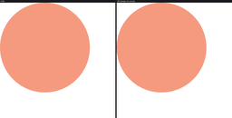](images/pair_cdo.png) | cdo | PASS | cdo child artboard |
| [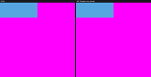](images/pair_dsm.png) | dsm | PASS | dsm bind pose (SM-name artifact resolved) |
| [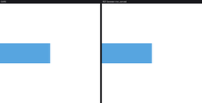](images/pair_dsm_row.png) | dsm_row | PASS | dsm bound row |
| [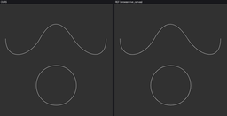](images/pair_clfp.png) | clfp | PASS | clfp Main t1 |
|  | clfp_item | PASS | clfp Item VM-bound |
| [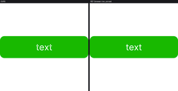](images/pair_cl1_item.png) | cl1_item | PASS | cl1 Item per-row VM |
|  | cl1_main | PASS | cl1 Main scroll+layout |
|  | clv | PASS | clv clipped viewport absolute layout |
| [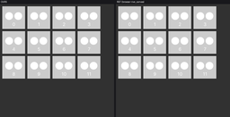](images/pair_cl2.png) | cl2 | PASS | cl2 NumberToList synthetic grid + flexWrap |
| [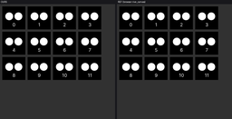](images/pair_cl2_t10.png) | cl2_t10 | PASS | cl2 color keyframes animate item fill at t10 |
|  | clfp_hover | PASS | clfp Item SM listener Hover:true@5 -> transition crossfade |
| [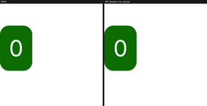](images/pair_kn_sm_input.png) | kn_sm_input | PASS | NATIVE raster SM-input class: clfp Item Hover:true@5 (render_kn_sm_input.k) |
| [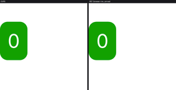](images/pair_kn_clfp_item.png) | kn_clfp_item | PASS | NATIVE clfp Item VM-bound list |
|  | kn_cl2_t10 | PASS | NATIVE cl2 animated keyframes t10 |
| [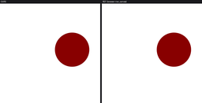](images/pair_clip.png) | clip | PASS | clip_tests Hidden-Path-Visible-Path |
| [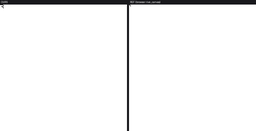](images/pair_cin.png) | cin | PASS | custom_image_name — image decode LIVE, browser drops alpha (spec-correct)  [VACUOUS: both sides ~empty] |
|  | iba | PASS | in_band_asset — 1x1 grayscale PNG, vacuous both sides  [VACUOUS: both sides ~empty] |
| [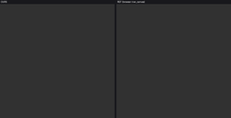](images/pair_lwti.png) | lwti | PASS | library_with_text_and_image — type-544 formula token, out-of-scope  [VACUOUS: both sides ~empty] |
| [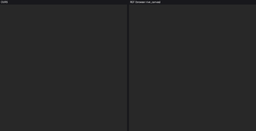](images/pair_deam.png) | deam | PASS | databind_external_artboard_main — VM-data class  [VACUOUS: both sides ~empty] |
|  | hff | PASS | hosted_font_file — hosted font 404  [VACUOUS: both sides ~empty] |
| [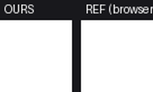](images/pair_dcpo.png) | dcpo | PASS | drawable_custom_properties_other — vacuous  [VACUOUS: both sides ~empty] |
|  | kn_cl2 | PASS | NATIVE raster cl2 (koru-native surface, no macOS bridge) |
|  | kn_hw | PASS | NATIVE raster hw |
|  | kn_cl1 | PASS | NATIVE raster cl1 |
| [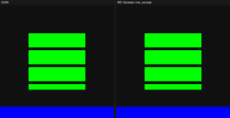](images/pair_kn_clv.png) | kn_clv | PASS | NATIVE raster clv |
| [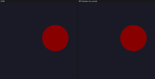](images/pair_kn_clip.png) | kn_clip | PASS | NATIVE raster clip_tests (nested path clips) |
|  | knm_cl2 | PASS | METAL raster cl2 (GPU path) |
| [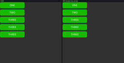](images/pair_knm_cl1.png) | knm_cl1 | PASS | METAL raster cl1 |
|  | knm_clv | PASS | METAL raster clv |
|  | knm_clip | PASS | METAL raster clip_tests |
| [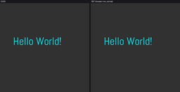](images/pair_knm_hw.png) | knm_hw | PASS | METAL raster hw (stencil-parity eo) |
| [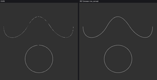](images/pair_mesh.png) | mesh | FAIL | mesh path — placement exact, AA verified pixel no-op  [failed: ink-mass, coverage-gap, ink-coverage, anti-aliasing] |
