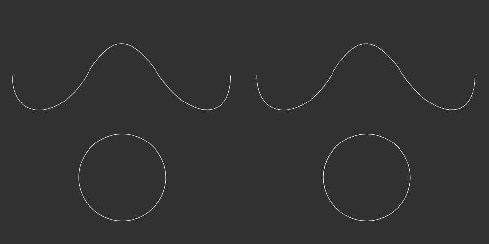
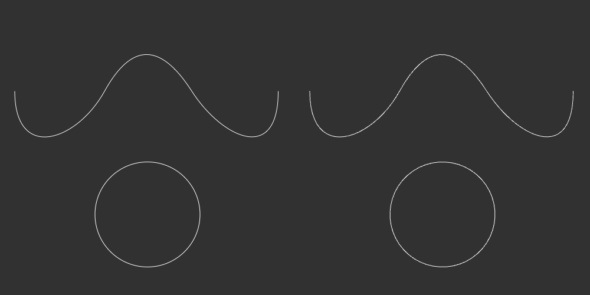
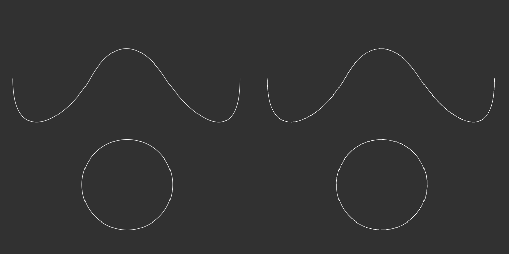
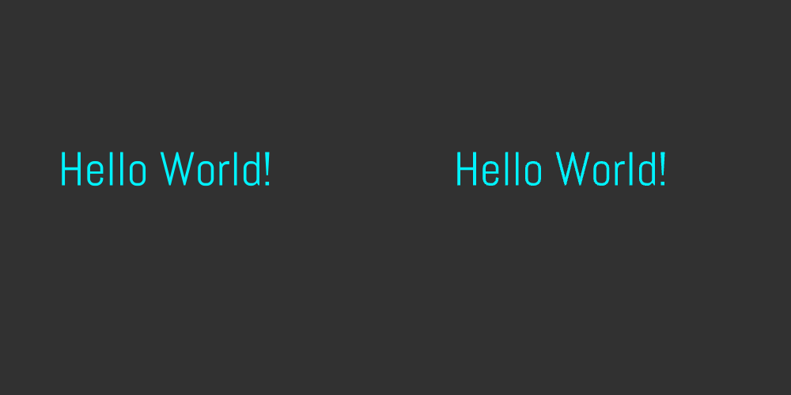
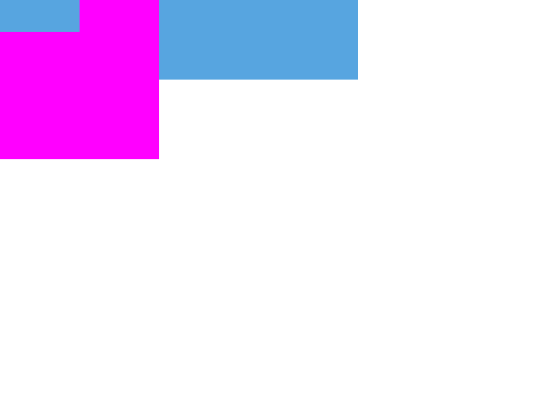

# Side-by-side: ours vs reference

Each row is `OURS | REF` at matched frames. REF = `render_browser.mjs`
(rive_canvas 2.37.0, headless Chromium, deterministic tick pump — the
decided backend; `rive_webgl` available via the same script).
OURS = `render_*.k` offscreen probes (magenta clear, `probe:step` replay).

Frame mapping (STATE.md §8): clfp `frame = 2*(tick-1)`; dsm/hw `frame = tick-1`.

## component_list_follow_path — artboard Main (500×500)

| tick | ours frame | pair |
|---|---|---|
| 1 | 0 |  |
| 5 | 8 |  |
| 10 | 18 |  |

- <check> Tier-1 frame-0 transforms/styles/colors/V-coords vs golden → <verdict> MATCH (≤0.0003 scale delta; stroke draw order swapped — cosmetic, non-overlapping).
- <check> live gallery_live window → <verdict> PASS (160k nonzero px, 0 fallback, ~1,200 frames).
- <check> pixel-level RMSE vs ref → <verdict> calibration-only (142.3 → 48.7 after stroke-channel fix; residual = bg-source/transform details).

## hello_world — artboard New Artboard (500×500)

| tick | ours frame | pair |
|---|---|---|
| 1 | 0 |  |

- <check> static-shape parity vs ref tick 1 → <verdict> see image; hello_world has no SM gating — coverage should match closely.

## component_list_default_state_machine — artboard Main (500×500)

| tick | ours frame | pair |
|---|---|---|
| 1 | 0 |  |

- <check> ref required `BIND_VM=1` (ViewModel-bound rows; unbound = blank) → <verdict> ours renders file-items unbound — the named ViewModel-binding gap (§6.1); row content/count will differ by design until binding lands.
- <check> dsm SM name → <verdict> "State Machine 1" not found in file (console error, content still rendered via binding).

## Named live-surface defect (banked, undiagnosed)

**Flicker-then-disappear** on the live gallery surface — candidates:
per-frame `kr/rive:open`+`free` churn, ops empty past SM range
(disproven offscreen at fr≤500 — stable), transform stack imbalance in
the shared live canvas, or path-handle lifecycle under sustained replay.
Diagnose after this doc lands.
